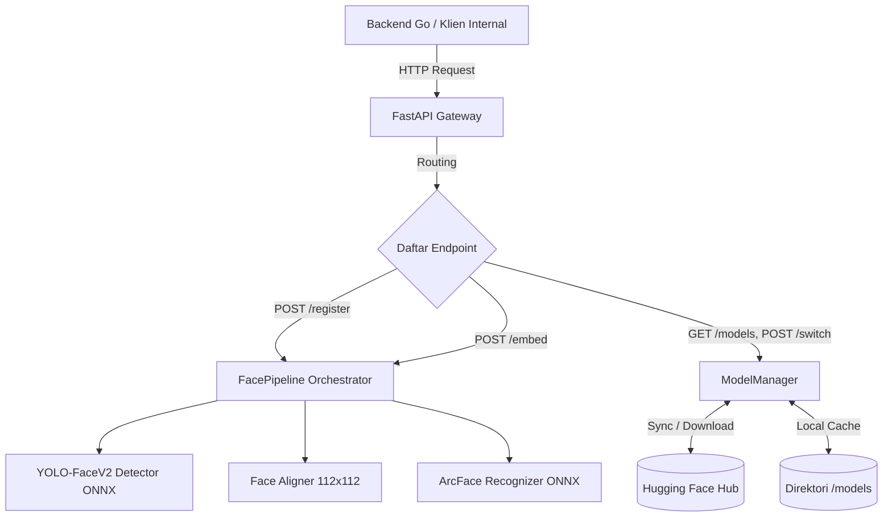
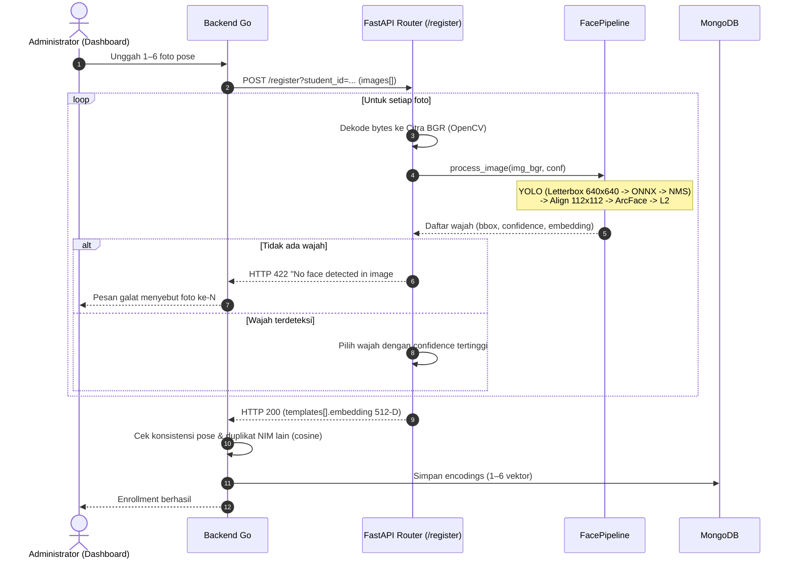
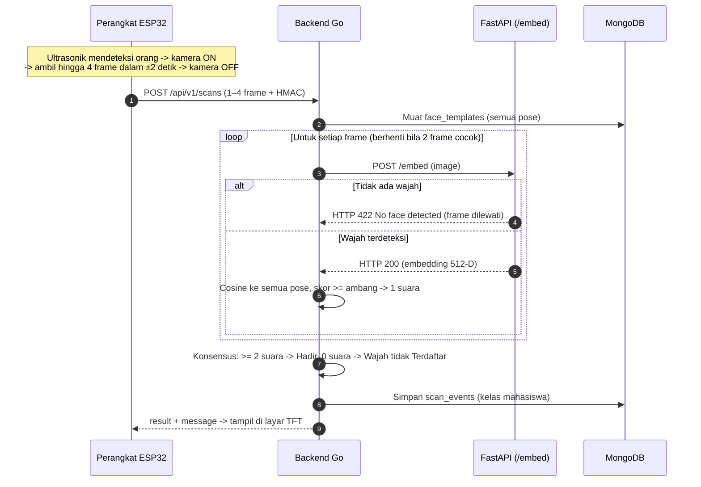
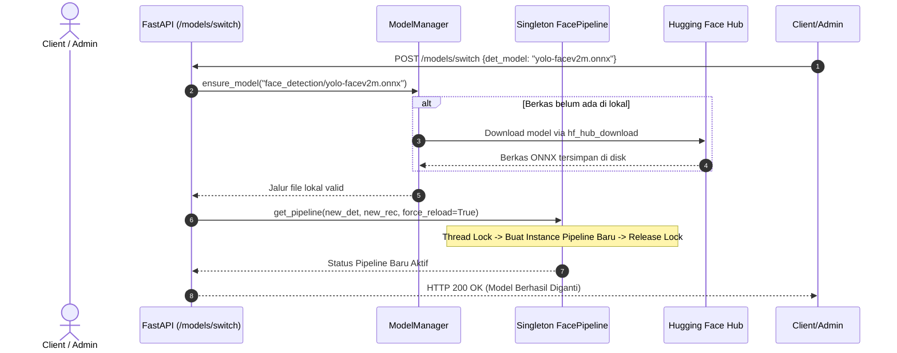

# Penjelasan Alur Sistem Face Recognition (Berbasis REST API)
Dokumen ini disusun untuk melengkapi bagian deskripsi alur fungsional pada dokumen **SRS (Software Requirements Specification)**. Dokumen ini menguraikan arsitektur sistem, alur proses komputasi, dan siklus hidup pemrosesan data ketika pengguna/klien berinteraksi melalui antarmuka REST API.

---

## 1. Ikhtisar Arsitektur Sistem (System Overview)

Sistem ini merupakan layanan mikro (*microservice*) biometrik berbasis **FastAPI** yang mengintegrasikan dua model *deep learning* utama dengan eksekusi berbasis **ONNX Runtime**:
1. **Deteksi Wajah (Face Detection):** Menggunakan arsitektur **YOLO-FaceV2** (varian *Small* atau *Medium*) untuk melokalisasi wajah manusia secara *real-time* dalam berbagai skala dan kondisi pencahayaan.
2. **Penyelarasan Wajah (Face Alignment):** Menggunakan transformasi afina (*Affine Transformation*) untuk memetakan area wajah hasil deteksi ke ruang kanonikal berukuran $112 \times 112$ piksel sesuai standar ArcFace.
3. **Pengenalan Wajah (Face Recognition / Feature Extraction):** Menggunakan arsitektur **ArcFace (ResNet-50)** untuk mengekstraksi representasi fitur wajah berdimensi 512 (*512-dimensional embedding vector*) yang dinormalisasi $L_2$.
4. **Model Asset Manager:** Modul pengelola model yang terintegrasi langsung dengan **Hugging Face Hub** (`AkihikoSaburo/methics`) untuk kebutuhan katalogisasi, pengunduhan otomatis (*auto-download*), dan pergantian model saat aplikasi berjalan (*hot-switching*).

Layanan ini **stateless**: tidak menyimpan embedding dan tidak terhubung ke
basis data. Penyimpanan template wajah (MongoDB) dan pencocokan identitas
1:N dilakukan oleh **backend Go**, yang menjadi satu-satunya API publik untuk
dashboard dan perangkat ESP32 (lihat bagian 3.3).

---

## 2. Alur Inisialisasi dan Startup Server (Lifespan Startup)

Sebelum API dapat melayani permintaan klien, sistem menjalankan mekanisme inisialisasi pada siklus hidup (*lifespan*) FastAPI:
1. **Pembacaan Konfigurasi:** Sistem membaca variabel lingkungan (`settings`) dan file konfigurasi model (`models_config.json`).
2. **Pemeriksaan Model Lokal & Auto-Download:** `ModelManager` memastikan berkas model ONNX (deteksi dan rekognisi) telah tersedia di direktori lokal (`models/face_detection/` dan `models/face_recognition/`). Apabila model belum tersedia, sistem secara otomatis mengunduhnya dari repositori Hugging Face.
3. **Pemuatan Sesi ONNX Runtime:** `FacePipeline` memuat bobot model ke memori menggunakan *inference engine* ONNX Runtime (memprioritaskan `CUDAExecutionProvider` jika GPU tersedia, atau fallback ke `CPUExecutionProvider`).
4. **Alokasi Singleton:** Instance `FacePipeline` disimpan sebagai objek tunggal (*thread-safe singleton*) yang siap digunakan bersama oleh seluruh *worker thread* permintaan HTTP.

---

## 3. Alur Fungsional API

### 3.1. Alur Registrasi Wajah Mahasiswa (`POST /register`)

Endpoint ini dipakai saat **enrollment**: administrator mengunggah 1–6 foto
seorang mahasiswa dengan pose berbeda (depan, kiri ~30°, kanan ~30°, atas,
bawah, senyum), dan sistem mengembalikan satu vektor fitur 512-D untuk
setiap foto.

#### Tahapan Alur Komputasi:
1. **Penerimaan Berkas (Request Handling):**
   - Klien mengirimkan 1–6 citra via *multipart/form-data* pada field `images`, beserta parameter query `student_id` (wajib), `return_aligned`, dan `conf_threshold` (opsional).
   - Jumlah foto divalidasi: 0 foto atau lebih dari 6 foto menghasilkan HTTP `400 Bad Request`.
2. **Dekoding Citra:**
   - Setiap byte stream didekode menjadi matriks array BGR menggunakan OpenCV (`cv2.imdecode`).
   - Jika citra rusak atau kosong, sistem mengembalikan kode status HTTP `400 Bad Request`.
3. **Prapemrosesan Deteksi (Pre-processing YOLO):**
   - Citra masukan diubah ukurannya menggunakan teknik **Letterbox Resize** menjadi dimensi $640 \times 640$ piksel dengan mempertahankan *aspect ratio* (memberikan *padding* abu-abu pada sisa ruang).
   - Nilai piksel dikonversi dari BGR ke RGB, dinormalisasi ke rentang $[0.0, 1.0]$, dan ditransposisi menjadi format tensor `[1, 3, 640, 640]`.
4. **Inferensi YOLO-FaceV2 (Detection Inference):**
   - ONNX Runtime mengeksekusi model deteksi pada 3 skala stride (P3=8, P4=16, P5=32).
   - Sistem mendekode kotak jangkar (*anchor boxes*), menerapkan fungsi sigmoid pada koordinat dan probabilitas objek.
   - Algoritma **Non-Maximum Suppression (NMS)** dieksekusi dengan ambang IoU (default 0.45) untuk mengeliminasi deteksi ganda/tumpang tindih.
   - Koordinat *bounding box* ditransformasikan kembali (*rescale*) ke dimensi citra asli dalam format $[x_1, y_1, x_2, y_2]$.
   - Jika tidak ada wajah pada salah satu foto, proses dihentikan dengan HTTP `422 Unprocessable Entity` dan pesan `"No face detected in image #N ('<nama file>')"`.
5. **Seleksi Wajah Utama:**
   - Bila satu foto berisi lebih dari satu wajah, sistem memilih **wajah dengan confidence tertinggi**.
6. **Penyelarasan Wajah (Face Alignment):**
   - Modul `FaceAligner` memotong (*crop*) area wajah berdasarkan titik pusat dan dimensi *bounding box* dengan rasio margin $25\%$.
   - Dilakukan transformasi afina kanonikal (`cv2.warpAffine`) untuk memetakan proporsi wajah ke kanvas standar berukuran $112 \times 112$ piksel.
7. **Ekstraksi Fitur (Feature Extraction ArcFace):**
   - Citra wajah $112 \times 112$ dinormalisasi ke standar ArcFace:
     $$\text{Norm}(x) = \frac{x - 127.5}{128.0}$$
   - Model ArcFace ONNX mengekstraksi vektor representasi laten berdimensi 512.
   - Vektor dinormalisasi menggunakan norma $L_2$ Euclidean:
     $$\mathbf{e} = \frac{\mathbf{v}}{\|\mathbf{v}\|_2}$$
     sehingga panjang vektor bernilai tepat 1 ($\|\mathbf{e}\|_2 = 1.0$).
8. **Penyusunan Respons:**
   - Mengembalikan JSON berisi `student_id`, jumlah template (`num_templates`), daftar `templates` (per foto: `embedding` 512 float, `confidence`, dan `aligned_face_b64` bila `return_aligned=true`), serta waktu komputasi total (`processing_time_ms`).
   - Embedding **tidak disimpan** oleh layanan ini; backend Go yang memvalidasi dan menyimpannya ke MongoDB (`face_templates.encodings`).

---

### 3.2. Alur Ekstraksi Embedding untuk Absensi (`POST /embed`)

Endpoint ini dipakai saat **absensi**: kamera ESP32-CAM menyala ketika sensor
ultrasonik mendeteksi orang, perangkat mengambil hingga 4 frame selama ±2
detik dan mengirim semuanya ke backend Go, lalu Go meneruskan **setiap frame**
ke `/embed`.
1. Klien mengirimkan satu citra pada field `image` (opsional `conf_threshold`).
2. Sistem menjalankan tahap 2–7 yang sama seperti bagian 3.1 dan memilih wajah dengan skor *confidence* tertinggi.
3. Jika tidak ada wajah, sistem mengembalikan HTTP `422 Unprocessable Entity` (`"No face detected in the uploaded image"`).
4. Sistem mengembalikan vektor embedding 512-D, nilai confidence, dan latensi pemrosesan (`processing_time_ms`).

---

### 3.3. Pencocokan Identitas di Backend Go

Pencocokan wajah (*1-to-N identification*) **tidak** dilakukan oleh layanan
Python, melainkan oleh backend Go terhadap seluruh template di MongoDB:

1. **Kalkulasi Kemiripan:** Karena vektor embedding $\mathbf{e}_1$ dan $\mathbf{e}_2$ telah ternormalisasi $L_2$ ($\|\mathbf{e}\| = 1$):
   $$\text{Cosine Similarity} = \mathbf{e}_1 \cdot \mathbf{e}_2 = \sum_{i=1}^{512} e_{1,i} \cdot e_{2,i}$$
   Rentang nilai berada pada interval $[-1.0, 1.0]$, di mana nilai mendekati $1.0$ mengindikasikan wajah yang identik.
2. **Skor per Mahasiswa:** Setiap mahasiswa memiliki 1–6 vektor pose; skornya pada satu frame adalah kemiripan **tertinggi** di antara pose-pose tersebut:
   $$\text{skor}(m) = \max_{k} \; \mathbf{e}_{\text{scan}} \cdot \mathbf{e}_{m,k}$$
3. **Pengambilan Keputusan (Thresholding):** Mahasiswa dengan skor tertinggi dinyatakan cocok bila
   $$\text{skor} \ge \text{threshold} \quad (\texttt{FACE\_SIM\_THRESHOLD}, \text{default } 0.45)$$
   Frame yang memenuhi ambang dihitung sebagai satu suara untuk mahasiswa tersebut.
4. **Konsensus Frame:** Mahasiswa dengan suara terbanyak dipilih. Bila wajah yang sama cocok di ≥ `SCAN_MIN_MATCH_FRAMES` frame (default 2), status langsung **Hadir** dan dicatat di kelas mahasiswa itu; cocok di 1 frame saja → **Perlu ditinjau**; ada wajah tetapi tidak ada yang cocok → **Ditolak** dengan tampilan layar *"Wajah tidak Terdaftar"*; tidak ada wajah → *"Wajah tidak terdeteksi"*. Konsensus ini bukan deteksi *liveness* (anti-spoof).
5. **Validasi saat Registrasi:** Go memastikan semua foto registrasi adalah orang yang sama — kemiripan tiap foto dengan foto pertama **atau** dengan rata-rata foto lain harus ≥ `FACE_POSE_THRESHOLD` (default 0.30, lebih longgar karena pose miring wajar kurang mirip foto depan) — dan wajah belum terdaftar atas NIM lain (≥ `FACE_SIM_THRESHOLD`).

---

### 3.4. Alur Manajemen dan Pergantian Model Dinamis (Model Management API)

Sistem memiliki kapabilitas pergantian model secara dinamis tanpa perlu mematikan atau me-restart aplikasi (*zero-downtime hot reloading*).

#### 1. Katalogisasi Model (`GET /models`):
- Klien memanggil endpoint untuk mengetahui daftar model yang terdaftar pada konfigurasi dan ketersediaannya di Hugging Face Hub.
- Sistem mengembalikan metadata model: ukuran input, ambang batas default, ukuran berkas (*file size*), serta status apakah model sudah terunduh di disk lokal (`downloaded: true/false`).

#### 2. Pengunduhan Model Terarah (`POST /models/download`):
- Klien mengirimkan `model_id` (misalnya: `"face_detection/yolo-facev2m.onnx"`).
- `ModelManager` menghubungi Hugging Face Hub, mengunduh berkas biner ONNX ke direktori lokal `models/`, dan memverifikasi integritas berkas.

#### 3. Pergantian Model Aktif (`POST /models/switch`):
- Klien mengirimkan permintaan pergantian model aktif (misal mengganti detektor dari versi *Small* ke *Medium*, atau menyesuaikan ambang batas NMS/Confidence).
- Sistem memicu `get_pipeline(force_reload=True)` dengan parameter baru.
- Berkas model baru dimuat ke memori ONNX Runtime secara atomik melalui penguncian *thread lock* (`threading.Lock`), sehingga sesi inferensi aktif sebelumnya tidak terganggu.

---

### 3.5. Alur Pemantauan Kesehatan Sistem (`GET /health`)

Endpoint ini berfungsi sebagai *readiness probe* dan *liveness probe* untuk infrastruktur seperti Kubernetes atau Docker Compose:
- Mengembalikan status kesiapan server (`status: "ok"`).
- Menyajikan informasi waktu aktif server (*uptime in seconds*).
- Menampilkan nama berkas model deteksi dan rekognisi yang sedang aktif di memori.

---

## 4. Matriks Ringkasan Endpoint API

| Metode HTTP | Endpoint | Deskripsi Fungsi | Parameter Input Kunci | Format Keluaran |
| :--- | :--- | :--- | :--- | :--- |
| **GET** | `/health` | Pemeriksaan status dan kesiapan server | - | `application/json` |
| **GET** | `/models` | Menampilkan katalog model lokal & Hugging Face | `refresh_remote` (query boolean) | `application/json` |
| **POST** | `/models/download` | Mengunduh bobot model dari Hugging Face Hub | `model_id`, `force` (JSON body) | `application/json` |
| **POST** | `/models/switch` | Mengganti model aktif secara dinamis (*hot-switch*) | `det_model`, `rec_model` (JSON body) | `application/json` |
| **POST** | `/register` | Registrasi mahasiswa: 1–6 foto pose → satu embedding 512-D per foto | `student_id` (query), `images` (file, 1–6), `return_aligned`, `conf_threshold` | `application/json` |
| **POST** | `/embed` | Mengekstraksi vektor 512-D wajah terbaik untuk absensi | `image` (file), `conf_threshold` | `application/json` |

---

## 5. Penanganan Kondisi Galat (Error Handling)

Dalam perancangan SRS, alur alternatif penanganan kondisi galat didefinisikan sebagai berikut:

| Kode HTTP | Nama Galat | Kondisi Terjadinya | Tindakan Pemulihan Sistem |
| :--- | :--- | :--- | :--- |
| **400 Bad Request** | `Empty image file` / `Cannot decode image` | File yang diunggah kosong, bukan gambar valid, atau korup. | Menghentikan eksekusi sebelum inferensi dan mengembalikan pesan detail format. |
| **400 Bad Request** | `At least one image` / `Maximum of 6 registration images` | Jumlah foto pada `/register` 0 atau lebih dari 6. | Permintaan ditolak tanpa inferensi. |
| **400 Bad Request** | `Model Switch/Download Error` | Model ID tidak ditemukan di repositori atau koneksi unduh terputus. | Pipeline tetap mempertahankan model lama yang sedang aktif. |
| **422 Unprocessable Entity** | `No face detected` | Citra pada `/embed`, atau salah satu foto pada `/register` (`image #N`), tidak memuat wajah yang memenuhi ambang batas deteksi. | Mengembalikan respons eksplisit bahwa subjek wajah tidak ditemukan; backend Go menampilkan nomor foto yang gagal. |
| **503 Service Unavailable** | `Models not initialized` | Permintaan masuk sebelum siklus *lifespan startup* selesai memuat model ke memori. | Klien disarankan melakukan *retry* dengan strategi *exponential backoff*. |
