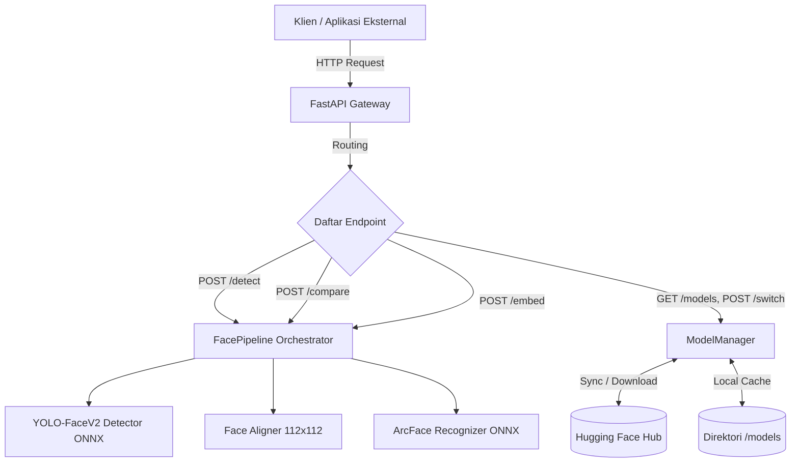
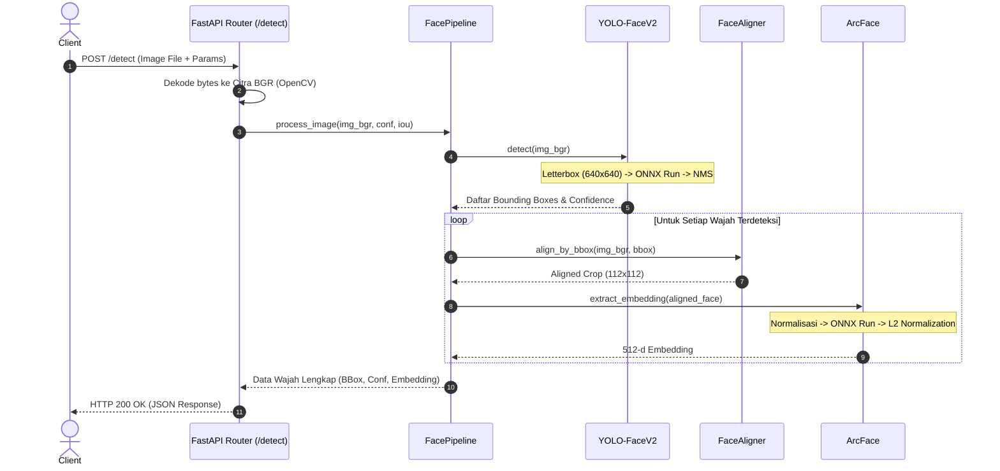
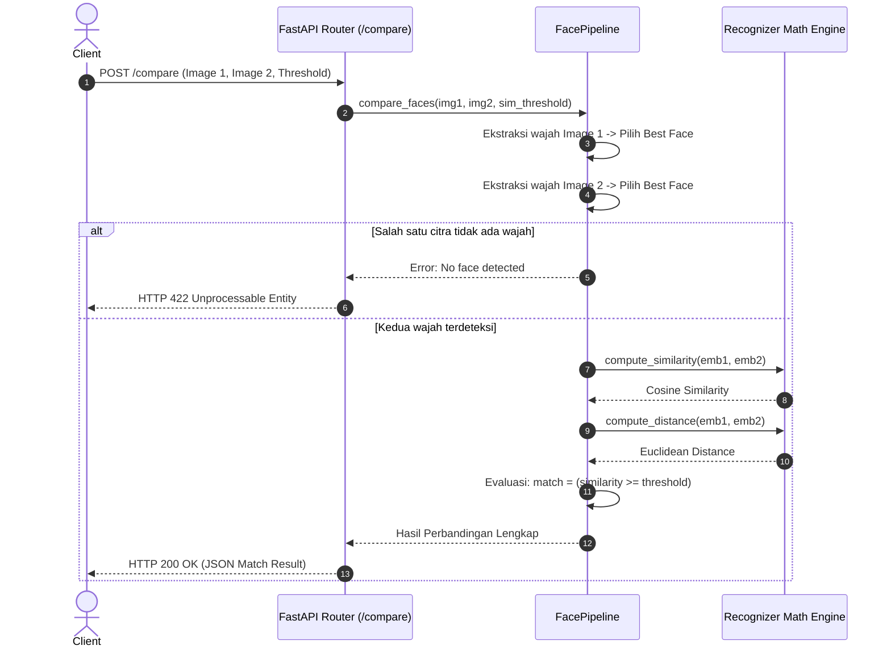
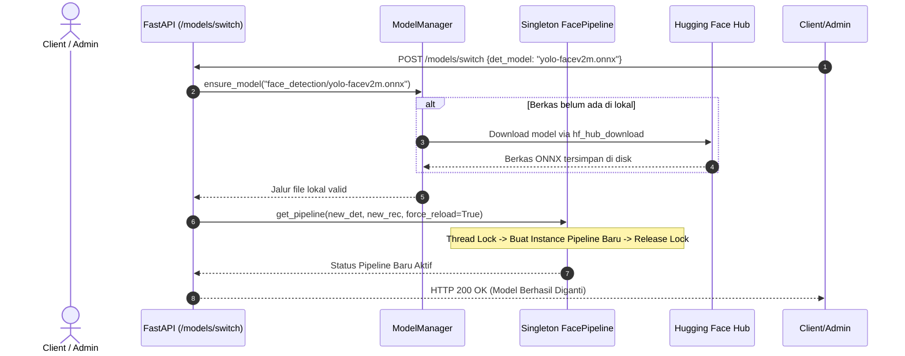

# Penjelasan Alur Sistem Face Recognition (Berbasis REST API)
Dokumen ini disusun untuk melengkapi bagian deskripsi alur fungsional pada dokumen **SRS (Software Requirements Specification)**. Dokumen ini menguraikan arsitektur sistem, alur proses komputasi, dan siklus hidup pemrosesan data ketika pengguna/klien berinteraksi melalui antarmuka REST API.

---

## 1. Ikhtisar Arsitektur Sistem (System Overview)

Sistem ini merupakan layanan mikro (*microservice*) biometrik berbasis **FastAPI** yang mengintegrasikan dua model *deep learning* utama dengan eksekusi berbasis **ONNX Runtime**:
1. **Deteksi Wajah (Face Detection):** Menggunakan arsitektur **YOLO-FaceV2** (varian *Small* atau *Medium*) untuk melokalisasi wajah manusia secara *real-time* dalam berbagai skala dan kondisi pencahayaan.
2. **Penyelarasan Wajah (Face Alignment):** Menggunakan transformasi afina (*Affine Transformation*) untuk memetakan area wajah hasil deteksi ke ruang kanonikal berukuran $112 \times 112$ piksel sesuai standar ArcFace.
3. **Pengenalan Wajah (Face Recognition / Feature Extraction):** Menggunakan arsitektur **ArcFace (ResNet-50)** untuk mengekstraksi representasi fitur wajah berdimensi 512 (*512-dimensional embedding vector*) yang dinormalisasi $L_2$.
4. **Model Asset Manager:** Modul pengelola model yang terintegrasi langsung dengan **Hugging Face Hub** (`AkihikoSaburo/methics`) untuk kebutuhan katalogisasi, pengunduhan otomatis (*auto-download*), dan pergantian model saat aplikasi berjalan (*hot-switching*).

---

## 2. Alur Inisialisasi dan Startup Server (Lifespan Startup)

Sebelum API dapat melayani permintaan klien, sistem menjalankan mekanisme inisialisasi pada siklus hidup (*lifespan*) FastAPI:
1. **Pembacaan Konfigurasi:** Sistem membaca variabel lingkungan (`settings`) dan file konfigurasi model (`models_config.json`).
2. **Pemeriksaan Model Lokal & Auto-Download:** `ModelManager` memastikan berkas model ONNX (deteksi dan rekognisi) telah tersedia di direktori lokal (`models/face_detection/` dan `models/face_recognition/`). Apabila model belum tersedia, sistem secara otomatis mengunduhnya dari repositori Hugging Face.
3. **Pemuatan Sesi ONNX Runtime:** `FacePipeline` memuat bobot model ke memori menggunakan *inference engine* ONNX Runtime (memprioritaskan `CUDAExecutionProvider` jika GPU tersedia, atau fallback ke `CPUExecutionProvider`).
4. **Alokasi Singleton:** Instance `FacePipeline` disimpan sebagai objek tunggal (*thread-safe singleton*) yang siap digunakan bersama oleh seluruh *worker thread* permintaan HTTP.

---

## 3. Alur Fungsional API

### 3.1. Alur Deteksi Wajah (`POST /detect` dan `POST /detect/visualize`)

Endpoint ini digunakan untuk mendeteksi semua wajah manusia pada suatu citra masukan, menghasilkan koordinat *bounding box*, skor keyakinan (*confidence score*), dan vektor fitur (*embedding*) 512-D untuk setiap wajah.

#### Tahapan Alur Komputasi:
1. **Penerimaan Berkas (Request Handling):**
   - Klien mengirimkan citra via *multipart/form-data* bersama parameter opsional (`return_aligned`, `conf_threshold`, `iou_threshold`).
2. **Dekoding Citra:**
   - Byte stream dibaca dari memori dan didekode menjadi matriks array BGR menggunakan OpenCV (`cv2.imdecode`).
   - Dilakukan validasi format citra. Jika citra rusak atau kosong, sistem mengembalikan kode status HTTP `400 Bad Request`.
3. **Prapemrosesan Deteksi (Pre-processing YOLO):**
   - Citra masukan diubah ukurannya menggunakan teknik **Letterbox Resize** menjadi dimensi $640 \times 640$ piksel dengan mempertahankan *aspect ratio* (memberikan *padding* abu-abu pada sisa ruang).
   - Nilai piksel dikonversi dari BGR ke RGB, dinormalisasi ke rentang $[0.0, 1.0]$, dan ditransposisi menjadi format tensor `[1, 3, 640, 640]`.
4. **Inferensi YOLO-FaceV2 (Detection Inference):**
   - ONNX Runtime mengeksekusi model deteksi pada 3 skala stride (P3=8, P4=16, P5=32).
   - Sistem mendekode kotak jangkar (*anchor boxes*), menerapkan fungsi sigmoid pada koordinat dan probabilitas objek.
   - Algoritma **Non-Maximum Suppression (NMS)** dieksekusi dengan ambang IoU (default 0.45) untuk mengeliminasi deteksi ganda/tumpang tindih.
   - Koordinat *bounding box* ditransformasikan kembali (*rescale*) ke dimensi citra asli dalam format $[x_1, y_1, x_2, y_2]$.
5. **Penyelarasan Wajah (Face Alignment):**
   - Untuk setiap wajah yang terdeteksi, modul `FaceAligner` memotong (*crop*) area wajah berdasarkan titik pusat dan dimensi *bounding box* dengan rasio margin $25\%$.
   - Dilakukan transformasi afina kanonikal (`cv2.warpAffine`) untuk memetakan proporsi wajah ke kanvas standar berukuran $112 \times 112$ piksel.
6. **Ekstraksi Fitur (Feature Extraction ArcFace):**
   - Citra wajah $112 \times 112$ dinormalisasi ke standar ArcFace:
     $$\text{Norm}(x) = \frac{x - 127.5}{128.0}$$
   - Model ArcFace ONNX mengekstraksi vektor representasi laten berdimensi 512.
   - Vektor dinormalisasi menggunakan norma $L_2$ Euclidean:
     $$\mathbf{e} = \frac{\mathbf{v}}{\|\mathbf{v}\|_2}$$
     sehingga panjang vektor bernilai tepat 1 ($\|\mathbf{e}\|_2 = 1.0$).
7. **Penyusunan Respons:**
   - Pada endpoint `/detect`: Mengembalikan format JSON berisi jumlah wajah (`num_faces`), daftar koordinat bounding box, confidence score, array 512 float embedding, waktu komputasi (`processing_time_ms`), serta Base64 gambar wajah terpotong jika parameter `return_aligned=true`.
   - Pada endpoint `/detect/visualize`: Citra diberi anotasi kotak hijau dan teks skor confidence di atas setiap wajah, lalu dikirimkan kembali ke klien dalam format *binary stream* `image/jpeg`.

---

### 3.2. Alur Pencocokan/Verifikasi Dua Wajah (`POST /compare`)

Endpoint ini memverifikasi kesamaan identitas antara dua foto wajah (*1-to-1 face verification*), misalnya untuk kebutuhan presensi biometrik atau verifikasi identitas pengguna (KYC).

#### Tahapan Alur Komputasi:
1. **Penerimaan Dua Berkas Citra:**
   - Klien mengunggah `image1` dan `image2` melalui form data multipart, beserta nilai ambang kemiripan opsional (`sim_threshold`, default 0.45).
2. **Deteksi dan Seleksi Wajah Utama:**
   - Sistem memproses `image1` dan `image2` secara independen melalui `process_image()`.
   - Jika pada salah satu citra tidak ditemukan wajah sama sekali, sistem menghentikan proses dan mengembalikan kode status HTTP `422 Unprocessable Entity` beserta pesan galat: `"No face detected in Image X"`.
   - Apabila terdapat lebih dari satu wajah pada satu citra, sistem secara otomatis memilih **wajah dengan tingkat keyakinan (confidence) tertinggi** sebagai subjek perbandingan utama.
3. **Kalkulasi Metrik Kemiripan Biometrik:**
   Karena vektor embedding $\mathbf{e}_1$ dan $\mathbf{e}_2$ telah ternormalisasi $L_2$ ($\|\mathbf{e}\| = 1$), perhitungan metrik dilakukan dengan efisiensi tinggi:
   - **Cosine Similarity:**
     $$\text{Cosine Similarity} = \mathbf{e}_1 \cdot \mathbf{e}_2 = \sum_{i=1}^{512} e_{1,i} \cdot e_{2,i}$$
     Rentang nilai berada pada interval $[-1.0, 1.0]$, di mana nilai mendekati $1.0$ mengindikasikan wajah yang identik.
   - **Euclidean Distance:**
     Dihitung secara langsung melalui hubungan analitis dengan kesamaan kosinus:
     $$\text{Euclidean Distance} = \sqrt{\max(0.0, 2.0 - 2 \times \text{Cosine Similarity})}$$
     Rentang nilai berada pada interval $[0.0, 2.0]$, di mana nilai mendekati $0.0$ mengindikasikan wajah yang identik.
4. **Pengambilan Keputusan (Thresholding Match):**
   - Sistem membandingkan nilai `similarity` dengan `threshold`:
     $$\text{match} = \begin{cases} \text{true}, & \text{jika } \text{similarity} \ge \text{threshold} \\ \text{false}, & \text{jika } \text{similarity} < \text{threshold} \end{cases}$$
5. **Penyusunan Respons:**
   - Mengembalikan data JSON yang menyajikan skor kemiripan (`cosine_similarity`), jarak euklidian (`euclidean_distance`), batas ambang yang digunakan (`threshold`), status kecocokan boolean (`match`), skor keyakinan masing-masing wajah, dan waktu pemrosesan total dalam milidetik.

---

### 3.3. Alur Ekstraksi Vektor Fitur Tunggal (`POST /embed`)

Endpoint ini dirancang khusus untuk proses pendaftaran (*enrollment*) identitas ke dalam basis data vektor (*vector database*).
1. Klien mengirimkan citra tunggal berisi wajah.
2. Sistem mendeteksi wajah dengan skor *confidence* tertinggi pada citra tersebut.
3. Citra wajah dipotong, disejajarkan ke ukuran $112 \times 112$, dan diekstrak menjadi vektor embedding berdimensi 512.
4. Sistem mengembalikan vektor embedding mentah beserta nilai confidence dan latensi pemrosesan.

---

### 3.4. Alur Manajemen dan Pergantian Model Dinamis (Model Management API)

Sistem memiliki kapabilitas pergantian model secara dinamis tanpa perlu mematikan atau me-restart aplikasi (*zero-downtime hot reloading*).

#### 1. Katalogisasi Model (`GET /models`):
- Klien memanggil endpoint untuk mengetahui daftar model yang terdaftar pada konfigurasi dan ketersediaannya di Hugging Face Hub.
- Sistem mengembalikan metadata model: ukuran input, ambang batas default, ukuran berkas (*file size*), serta status apakah model sudah terunduh di disk lokal (`downloaded: true/false`).

#### 2. Pengunduhan Model Terarah (`POST /models/download`):
- Klien mengirimkan `model_id` (misalnya: `"face_detection/yolo-facev2m.onnx"`).
- `ModelManager` menghubungi Hugging Face Hub, mengunduh berkas biner ONNX ke direktori lokal `models/`, dan memverifikasi integritas berkas.

#### 3. Pergantian Model Aktif (`POST /models/switch`):
- Klien mengirimkan permintaan pergantian model aktif (misal mengganti detektor dari versi *Small* ke *Medium*, atau menyesuaikan ambang batas NMS/Confidence).
- Sistem memicu `get_pipeline(force_reload=True)` dengan parameter baru.
- Berkas model baru dimuat ke memori ONNX Runtime secara atomik melalui penguncian *thread lock* (`threading.Lock`), sehingga sesi inferensi aktif sebelumnya tidak terganggu.

---

### 3.5. Alur Pemantauan Kesehatan Sistem (`GET /health`)

Endpoint ini berfungsi sebagai *readiness probe* dan *liveness probe* untuk infrastruktur seperti Kubernetes atau Docker Compose:
- Mengembalikan status kesiapan server (`status: "ok"`).
- Menyajikan informasi waktu aktif server (*uptime in seconds*).
- Menampilkan nama berkas model deteksi dan rekognisi yang sedang aktif di memori.

---

## 4. Matriks Ringkasan Endpoint API

| Metode HTTP | Endpoint | Deskripsi Fungsi | Parameter Input Kunci | Format Keluaran |
| :--- | :--- | :--- | :--- | :--- |
| **GET** | `/health` | Pemeriksaan status dan kesiapan server | - | `application/json` |
| **GET** | `/models` | Menampilkan katalog model lokal & Hugging Face | `refresh_remote` (query boolean) | `application/json` |
| **POST** | `/models/download` | Mengunduh bobot model dari Hugging Face Hub | `model_id`, `force` (JSON body) | `application/json` |
| **POST** | `/models/switch` | Mengganti model aktif secara dinamis (*hot-switch*) | `det_model`, `rec_model` (JSON body) | `application/json` |
| **POST** | `/detect` | Mendeteksi wajah dan menghasilkan bounding box + embedding | `image` (file), `return_aligned` | `application/json` |
| **POST** | `/detect/visualize` | Mendeteksi wajah dan merender bounding box langsung pada citra | `image` (file), `conf_threshold` | `image/jpeg` |
| **POST** | `/compare` | Membandingkan 2 citra wajah (*verification*) | `image1`, `image2` (file), `sim_threshold` | `application/json` |
| **POST** | `/embed` | Mengekstraksi vektor 512-D wajah terbaik untuk registrasi | `image` (file), `conf_threshold` | `application/json` |

---

## 5. Penanganan Kondisi Galat (Error Handling)

Dalam perancangan SRS, alur alternatif penanganan kondisi galat didefinisikan sebagai berikut:

| Kode HTTP | Nama Galat | Kondisi Terjadinya | Tindakan Pemulihan Sistem |
| :--- | :--- | :--- | :--- |
| **400 Bad Request** | `Empty image file` / `Cannot decode image` | File yang diunggah kosong, bukan gambar valid, atau korup. | Menghentikan eksekusi sebelum inferensi dan mengembalikan pesan detail format. |
| **400 Bad Request** | `Model Switch/Download Error` | Model ID tidak ditemukan di repositori atau koneksi unduh terputus. | Pipeline tetap mempertahankan model lama yang sedang aktif. |
| **422 Unprocessable Entity** | `No face detected` | Citra pada `/compare` atau `/embed` tidak memuat wajah yang memenuhi ambang batas deteksi. | Mengembalikan respons eksplisit bahwa subjek wajah tidak ditemukan. |
| **503 Service Unavailable** | `Models not initialized` | Permintaan masuk sebelum siklus *lifespan startup* selesai memuat model ke memori. | Klien disarankan melakukan *retry* dengan strategi *exponential backoff*. |
